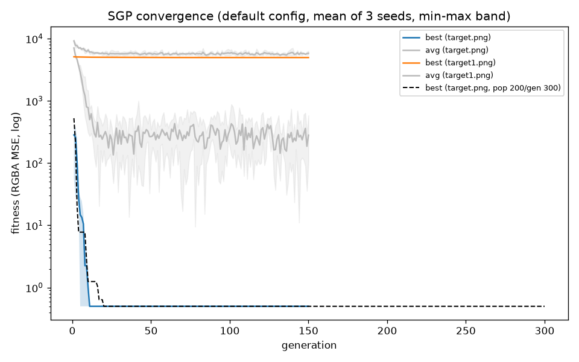
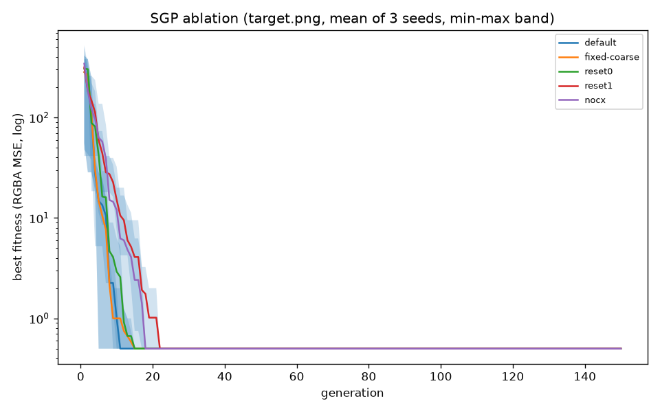
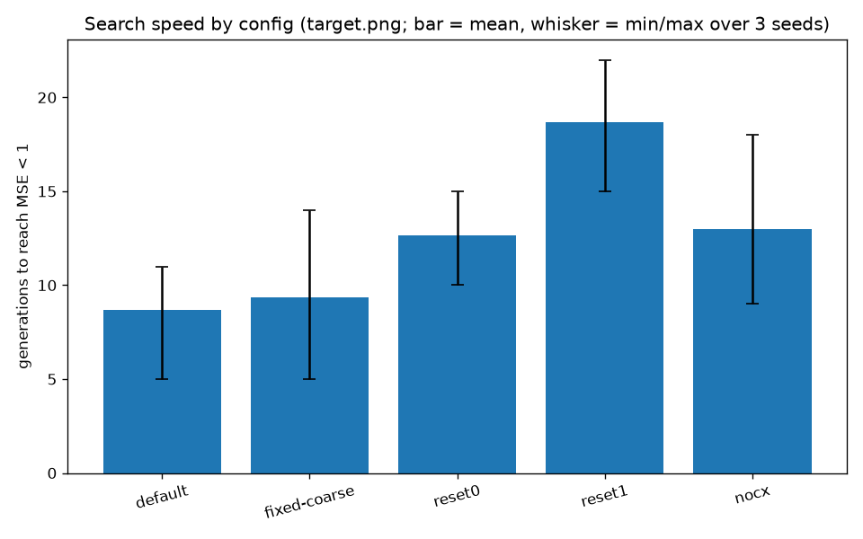
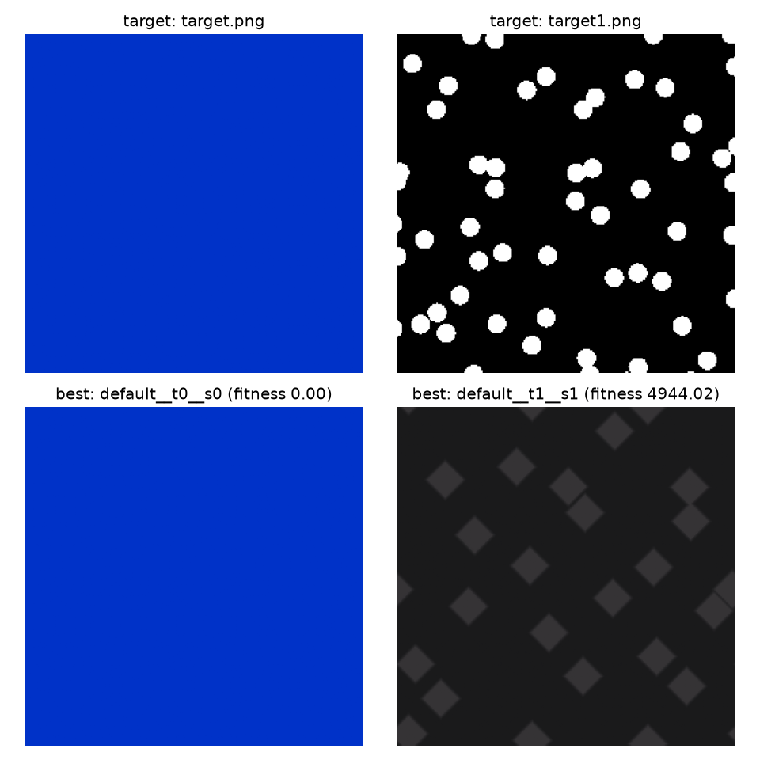

# SGP — Shader Generation Problem

I aim to solve the Shader Generation Problem using machine learning: **evolve
[`shader-gen`](https://github.com/k0T0z/shader-gen)** **shader graphs with a genetic algorithm.**

SGP keeps a graph's topology fixed and searches only over the parameters that shader-gen
declares as mutable (noise scales, colours, gradient stops, enum modes, …). Every candidate
is compiled to GLSL, rendered, and scored by how close its pixels are to a target image, so
the search is driven by real rendered output rather than a hand-written heuristic.

## How it works

## Results

**Setup.** Population 128 × 150 generations ≈ **15.6k evaluations** per run, 3 seeds per
configuration, one 256×256 target, offscreen rendering. Evaluation is GLSL-compile bound at
≈0.19 s per candidate, so runs were executed as 6 parallel processes. A single long reference
run (population 200 × 300 generations, ≈48.2k evaluations) is included in the convergence
figure.

### 1. The fixed topology solves `target.png` exactly

Every configuration and every seed reached a **final fitness of 0.000** on `target.png` — the
graph can represent that image pixel-for-pixel. Since the endpoint is the same for all of
them, the meaningful difference is **how fast each setting gets there**:

| configuration                              | mean generations to MSE < 1 | seeds solved |
| ------------------------------------------ | --------------------------- | ------------ |
| default                                    | **9**                       | 3 / 3        |
| fixed coarse sigma                         | 9                           | 3 / 3        |
| no reset (`--reset-probability 0`)         | 13                          | 3 / 3        |
| always reset (`--reset-probability 1`)     | 19                          | 3 / 3        |
| no crossover (`--crossover-probability 0`) | 13                          | 3 / 3        |







### 2. The topology cannot reach `target1.png`

Pointed at a different image, the same search **plateaus**: across all three seeds the best
fitness stalls at ≈**4.9k** (4944.0 / 4962.1 / 5005.8) and never approaches zero. That is the
expected signature of a *fixed* topology — once the reachable image set is exhausted, extra
generations do not help. It is exactly what motivates the next step: evolving the graph
itself, not just its parameters.



### 3. Watching one run

`results_evolution.gif` steps through the per-generation best on `target.png`, rendered with
the same offscreen path the GA scores against (the evolved shader beside the target):


## Layout

## Build

Requires MSVC (the Protobuf/Abseil binaries SGP links against are MSVC-built), CMake 3.21+,
and `pip install pybind11`.

The exact working invocation on this machine (Debug, dynamic Protobuf/Abseil):

```
git submodule update --init --recursive
cmake -S . -B build -G "Visual Studio 17 2022" -A x64 `
      -DCMAKE_PREFIX_PATH="C:/Users/saifs/Desktop/work/shader-gen-project/proto-lib-dynamic-debug;C:/Users/saifs/Desktop/work/shader-gen-project/absl-lib-dynamic-debug" `
      -Dpybind11_DIR="C:/Users/saifs/AppData/Local/Programs/Python/Python314/Lib/site-packages/pybind11/share/cmake/pybind11"
cmake --build build --config Debug
python ga.py
```

`<protobuf-prefix>` holds `lib/cmake/protobuf` and `lib/cmake/utf8_range`; `<absl-prefix>`
holds `lib/cmake/absl` (`python -m pybind11 --cmakedir` prints the pybind11 dir).

The extension lands in `build/python/` next to the protobuf/abseil DLLs it needs, which
`sga/runtime.py` registers via `os.add_dll_directory`.

### The shader-gen submodule

`SGP_SHADER_GEN_ROOT` defaults to `externals/shader-gen`, and that default is what the build
uses — no flag is needed. The submodule is pinned to shader-gen `master-qt6` (`a8287ae`,
"bump to v2.6.1.1"), which carries the Qt-free refactor the sources require: `generator/graph_string_utils.hpp`,
`proto_node.hpp`, `proto_node_factory.hpp`, `port_type_generator_factory.hpp`, and the
Qt-free `ai-agent/utils/utils.hpp` that `get_continuous_range` / `get_discrete_range` are
re-exported from. The cache variable is still there if you want to build against a different
shader-gen checkout.

## API

```python
import shader_gen_py

graph = "0;0;3,0;1;2;1=2,..."  # encoded raw graph, see below
status, glsl = shader_gen_py.generate_shader(graph)
```

